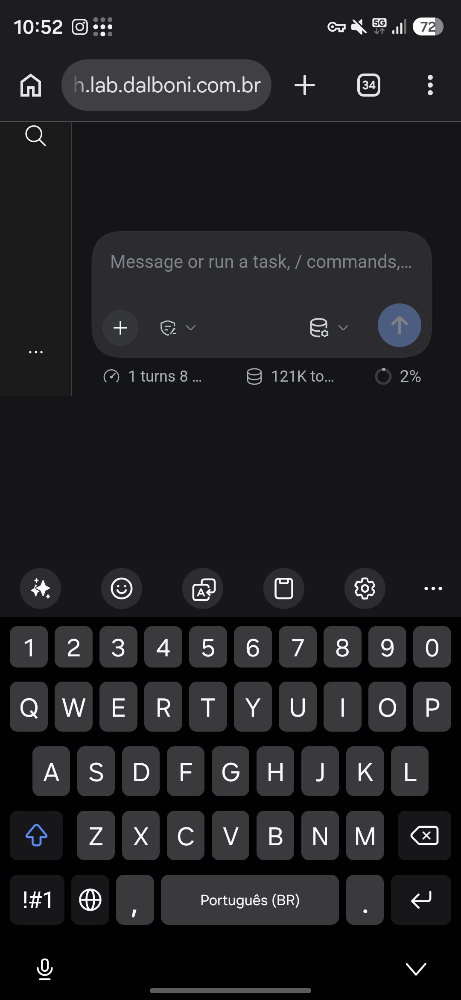
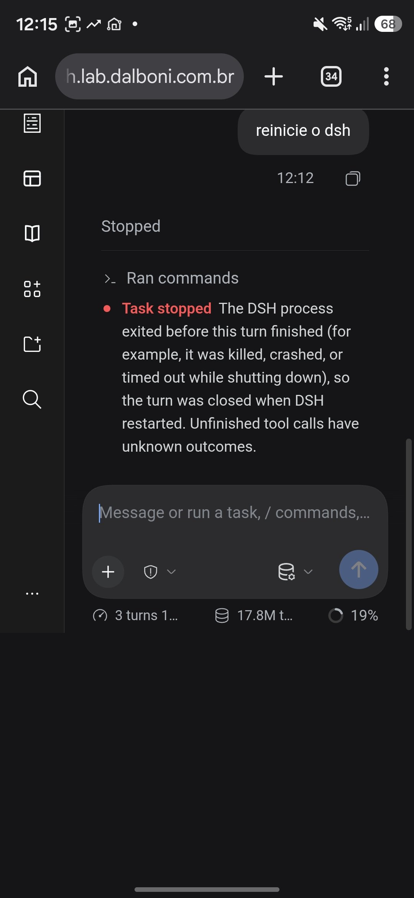

# dsh-mobile

Mobile viewport lock, overscroll containment, and virtual keyboard optimizations for DeepSeek Harness (DSH) Web GUI.

## Screenshots

| Fixed Mobile View | Before Fix (Limbo / Black Void) |
|:---:|:---:|
|  |  |

## Features

- **Viewport Lock**: Prevents the page (`html, body`) from scrolling or bouncing into the empty black space below the application.
- **Overscroll Containment**: Keeps scroll gestures inside `[data-conversation-scroll]` with `overscroll-behavior-y: contain`.
- **Virtual Keyboard Resizing**: Configures `interactive-widget=resizes-content` so virtual keyboards resize the viewport cleanly instead of panning the page.
- **Input Zoom Prevention**: Enforces a minimum `16px` font-size on text inputs for mobile viewports to prevent iOS and Android auto-zoom.

## Installation

Add to your DSH web profile (`~/.dsh/profiles/web/package.json`):

```json
{
  "dependencies": {
    "dsh-mobile": "^1.0.0"
  },
  "dsh": {
    "profile": {
      "bundles": [
        "dsh-mobile"
      ]
    }
  }
}
```

Or configure via `cordis.patch.yml`:

```yaml
- id: dsh-mobile
  name: dsh-mobile
```

## License

MIT © Maxwell Dalboni
