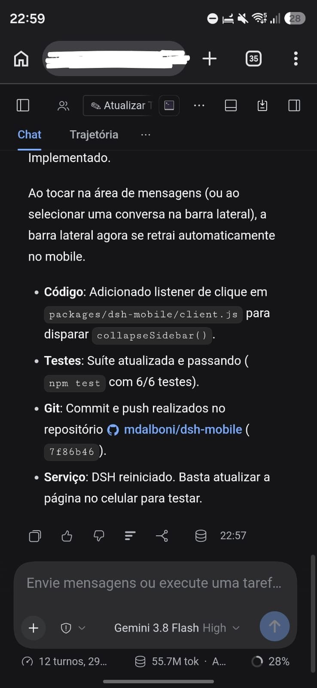
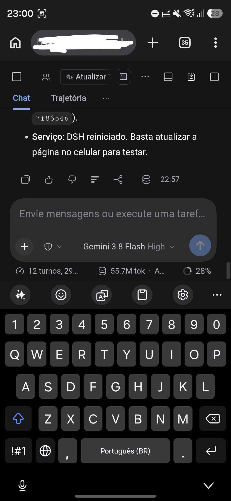
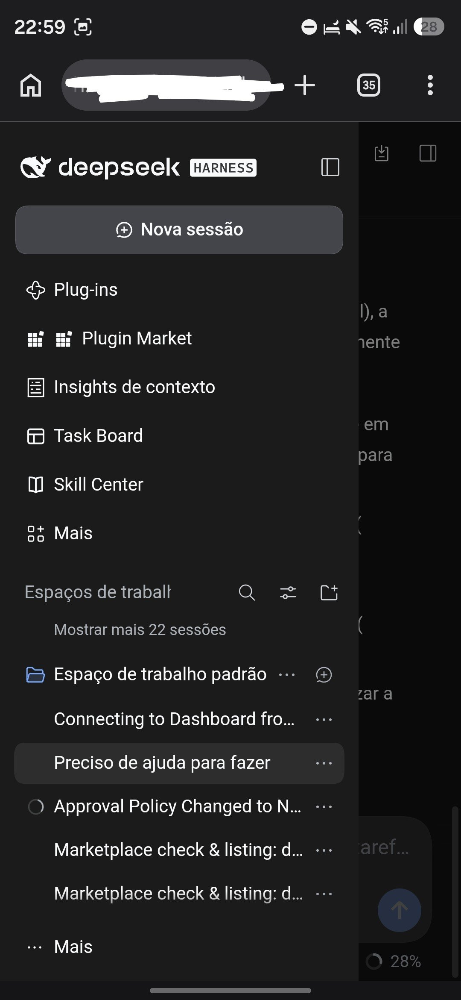

# dsh-mobile

Trava de viewport, contenção de overscroll e adaptações para teclado virtual no DeepSeek Harness (DSH) Web GUI.

## Capturas de Tela

| Visualização do Chat | Teclado Virtual Aberto | Barra Lateral Aberta |
|:---:|:---:|:---:|
|  |  |  |

## Recursos

- **Trava de Viewport**: Impede que a página (`html, body`) desloque ou role para o fundo preto vazio abaixo da aplicação.
- **Contenção de Overscroll**: Isola gestos de rolagem dentro de `[data-conversation-scroll]` usando `overscroll-behavior-y: contain`.
- **Adaptação para Teclado Virtual**: Configura `interactive-widget=resizes-content` para que o teclado virtual redimensione o espaço útil em vez de deslocar a tela inteira.
- **Auto-recolhimento da Barra Lateral**: Recolhe automaticamente o menu lateral ao tocar na área de mensagens ou ao selecionar uma conversa.
- **Prevenção de Zoom Indesejado**: Aplica tamanho mínimo de fonte de `16px` em campos de texto no mobile para evitar zoom automático no iOS/Android.

## Instalação

Adicione ao perfil web do DSH (`~/.dsh/profiles/web/package.json`):

```json
{
  "dependencies": {
    "dsh-mobile": "^1.0.0"
  },
  "dsh": {
    "profile": {
      "bundles": [
        "dsh-mobile"
      ]
    }
  }
}
```

Ou configure via `cordis.patch.yml`:

```yaml
- id: dsh-mobile
  name: dsh-mobile
```

## Licença

MIT © Maxwell Dalboni
